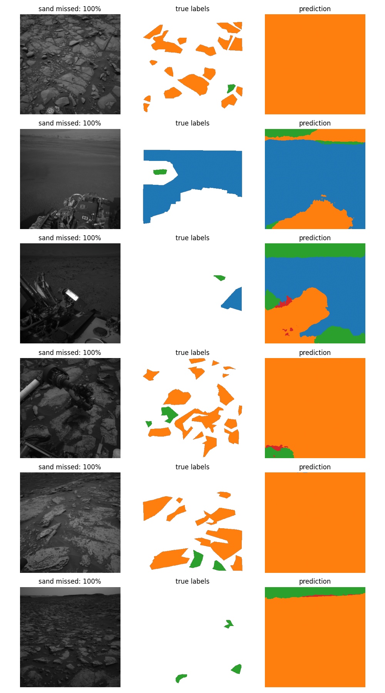

# Mars Terrain Segmentation

A DeepLabV3+ model that labels each pixel of a Mars rover image as soil, bedrock, sand or big rock.

## Results (expert-labeled test set)

| Model | Soil IoU | Bedrock IoU | Sand IoU | Big rock IoU | Mean IoU |
|---|---|---|---|---|---|
| All-soil baseline | 0.514 | 0.000 | 0.000 | 0.000 | 0.128 |
| My model | ... | ... | ... | ... | ... |

## What I did
(3 or 4 sentences in your own words: masks, class weights, training settings, what you learned from the sand errors.)

## Limitations
- Labels are crowdsourced and sparse.
- Trained on a subset of Curiosity images at 320x320.
- The big rock score is unstable because it appears in few test images.

Data: AI4Mars (NASA JPL).